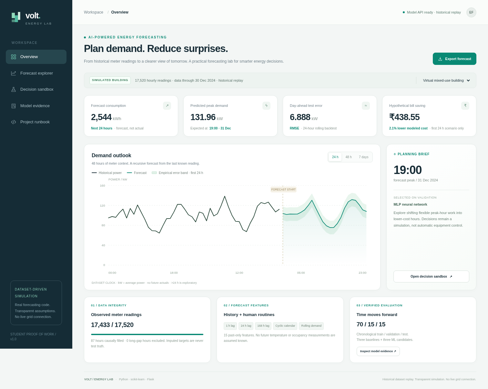
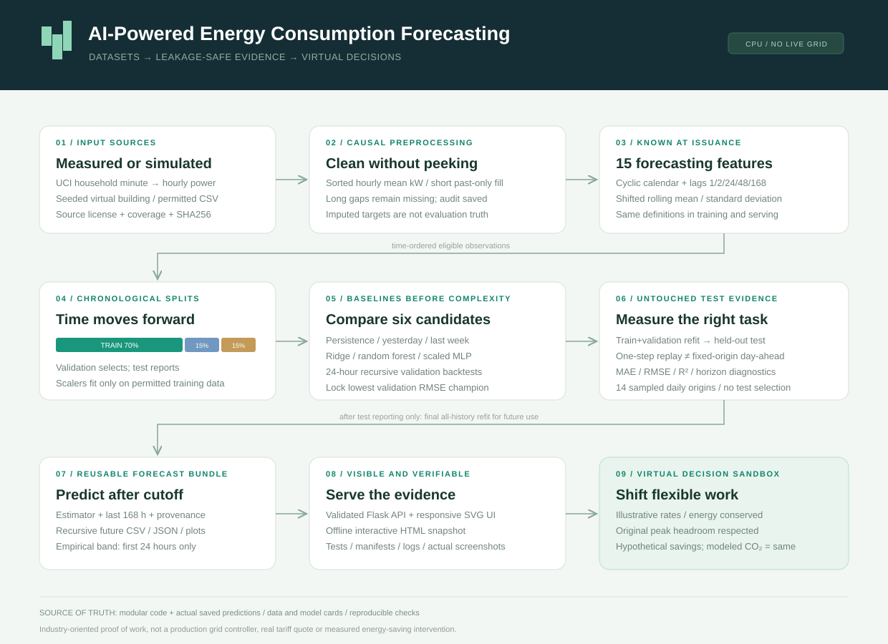
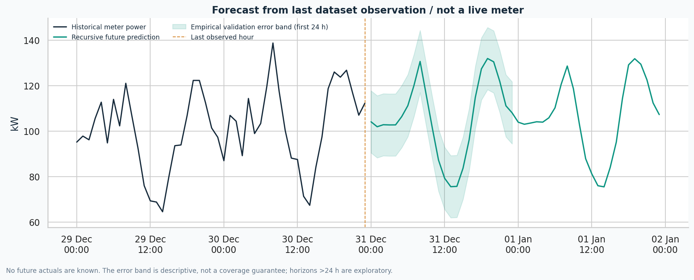
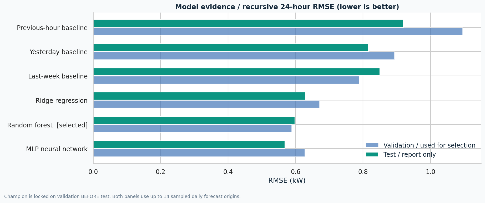
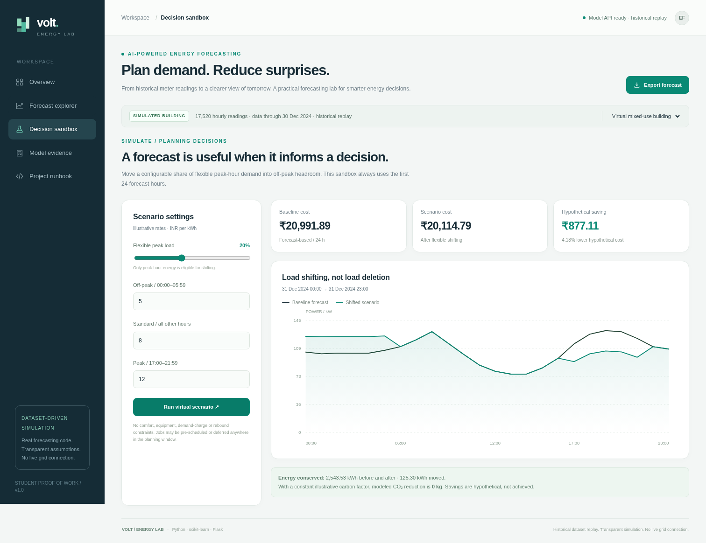
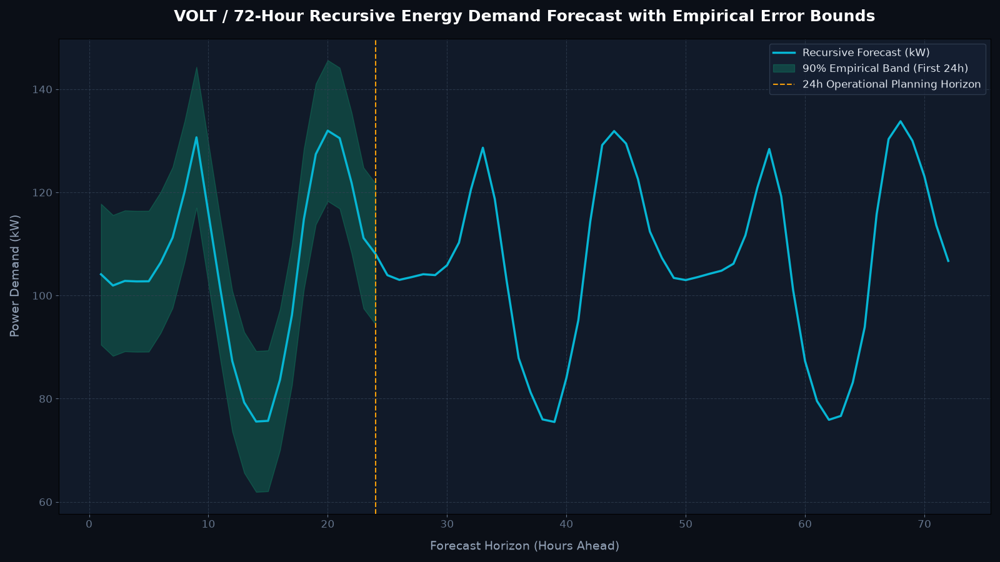
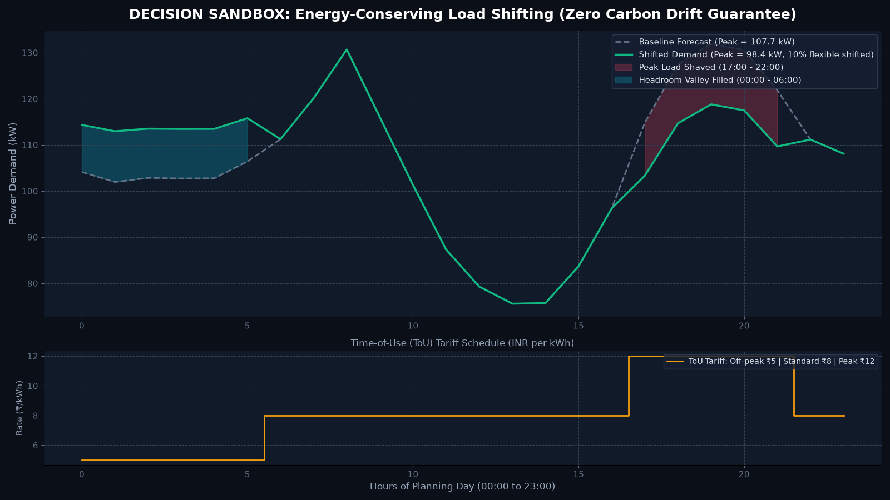

# ⚡ AI-Powered Energy Consumption Forecasting System

**An end-to-end, CPU-friendly machine-learning platform for hourly electricity demand forecasting, leakage-free backtesting, and interactive decision optimization.**

[](https://www.python.org/)
[](https://scikit-learn.org/)
[](https://flask.palletsprojects.com/)
[](tests/)
[](outputs/verification.json)
[](LICENSE)
[](https://rohitsingh83.github.io/AI-Energy-Forecasting/)

---

### 🌐 Live Interactive Web Dashboard
**Visit the live GitHub.io deployment:** [https://rohitsingh83.github.io/AI-Energy-Forecasting/](https://rohitsingh83.github.io/AI-Energy-Forecasting/)  
*(Runs fully client-side on GitHub Pages without requiring a backend server — switch datasets, explore forecasts, and adjust load shifting in real time!)*

[Start here](START_HERE.md) · [Complete A–M Guide](docs/PROJECT_GUIDE.md) · [Full Source](docs/FULL_SOURCE.md) · [Executed Notebook](notebooks/01_energy_forecasting.ipynb) · [Actual Results](docs/RESULTS.md) · [API Docs](docs/API.md)

<div align="center">
  
  <p><em>VOLT Energy Forecasting Lab: 48h historical context, 24h recursive forecast, and interactive decision sandbox.</em></p>
</div>

> **Transparency & Physical Grounding:** This is historical-data replay and virtual planning, not a live grid connection. Predictions follow the dataset cutoff, not today's date. Cost savings are hypothetical under Time-of-Use tariffs. Total energy (kWh) is strictly conserved; under constant grid carbon intensity, modeled emissions reduction is 0 kg. R² is coefficient of determination, not percentage accuracy.

## Overview

Energy demand changes with time, weather and human activity. Facility planners need
a defensible estimate of future demand to schedule flexible work, anticipate peaks
and budget energy. This repository implements the whole experiment rather than a
single model-fitting notebook: ingest, clean, engineer, compare, evaluate, forecast,
simulate, visualize, serve and verify.

### Problem statement

Uncertain hourly demand can make supply planning and peak-time electricity use
more difficult. The project estimates upcoming power and explores one possible
business response: shifting eligible work from illustrative peak-rate hours into
lower-rate headroom. **Forecasting is decision support, not a guarantee of grid
reliability or an automatic energy optimizer.**

### Industry relevance

| Context | Decision forecasting can support | Additional real-system needs |
|---|---|---|
| Smart homes/buildings | HVAC/flexible-appliance planning, consumption budgets | Comfort constraints and real tariffs |
| Smart cities | Aggregate facility demand and peak awareness | Representative multi-site data and network models |
| Electricity boards | Demand planning and procurement inputs | Grid constraints, reserves, weather and safety processes |
| Manufacturing | Scheduling flexible process loads | Production deadlines, machine limits, shift calendars |
| Data centers | Capacity/cooling planning inputs | SLA/thermal safety constraints and approved controls |
| Renewable energy | Demand/net-load planning | Separate solar/wind forecasts and storage constraints |

These are potential applications, not deployments performed by this project.

## What is implemented

- [x] Deterministic virtual-building generator: 17,520 hourly rows, realistic routines,
  temperature effects, occupancy proxies, noise and deliberately missing readings.
- [x] Genuine UCI household benchmark: 2,075,259 minute rows aggregated to hourly kW;
  bundled adaptation includes source/coverage/license metadata and SHA256 hashes.
- [x] Causal cleaning: sorted hourly grid, duplicate averaging, bounded past-only
  fill, long-gap preservation, original-observation mask.
- [x] 15 calendar/lag/rolling features with training–serving parity checks.
- [x] Previous-hour, yesterday and last-week baselines; Ridge, random forest and MLP.
- [x] Chronological 70/15/15 splits; champion locked on validation day-ahead RMSE.
- [x] Separate one-step and fixed-origin recursive 24-hour test evaluations.
- [x] Final all-history refit, reusable joblib bundle, 1–168-hour forecasts; >24 h
  explicitly exploratory, empirical error bands only for the first 24 h.
- [x] Energy-conserving, headroom-constrained load-shifting sandbox with transparent
  illustrative tariff assumptions and no invented carbon reduction.
- [x] Flask API, responsive five-view dashboard, standalone offline HTML export.
- [x] Nine analytical PNG figures per dataset, actual browser screenshots, CSV/JSON
  evidence, executed notebook and actual pipeline logs.
- [x] Automated unit/leakage/API/offline pipeline tests; artifact/browser checks;
  GitHub Actions workflow ready for your repository.

## Tech stack

| Layer | Choice |
|---|---|
| Python | 3.11–3.13; build evidence executed on 3.13.16 |
| Data | pandas, NumPy, public UCI CSV adaptation, seeded synthetic CSV |
| ML | scikit-learn Ridge, RandomForestRegressor, MLPRegressor |
| Scaling/serialization | StandardScaler pipelines, joblib |
| Evaluation | MAE, RMSE, R², MAPE, WAPE; rolling forecast origins |
| Visuals | matplotlib / seaborn; dependency-free SVG web charts |
| Serving | Flask JSON endpoints and inline HTML/CSS/JS |
| Quality | pytest; CI matrix for Python 3.11/3.12/3.13 |
| Hardware | CPU; no GPU, cloud account or paid service required |

Direct runtime dependencies are pinned in [requirements.txt](requirements.txt).
Three beginner-to-advanced alternatives are explained in the [guide](docs/PROJECT_GUIDE.md#b-tech-stack-options).

## Dataset

### 1. Synthetic virtual building — default, offline

`data/raw/energy_data.csv`, seed 42, 730 days starting 2023-01-01. `Energy_kW`
means **hour-average power**, despite the column's legacy name. Temperature and
occupancy are for exploration only; their future realized values are not assumed
known by the forecasting model. This is generated data, not smart-grid client logs.

### 2. Public measured household — real benchmark

Georges Hebrail & Alice Berard, **Individual Household Electric Power Consumption**,
UCI Machine Learning Repository, DOI [10.24432/C58K54](https://doi.org/10.24432/C58K54).
One household in Sceaux, France, December 2006–November 2010. Data: **CC BY 4.0**.

[Official dataset](https://archive.ics.uci.edu/dataset/235/individual+household+electric+power+consumption) ·
[Attribution & adaptations](DATA_LICENSE.md) · [Data card](docs/DATA_CARD.md)

The bundled hourly adaptation averages minute power only for hours with at least
54 valid source minutes. Unobserved boundary hours are trimmed. Final cleaned grid:
34,587 hours; 411 long-gap hours remain missing. Do not call this a city-scale grid
benchmark or a representative sample of households.

**Units:** hourly energy (kWh) = average power (kW) × 1 hour. The 24-hour forecast
energy is the sum of interval kWh, not the mean or sum of arbitrary-duration samples.

## Architecture

```text
 Public UCI minute archive ──> coverage-aware hourly aggregation ─┐
 Seeded virtual building ────────────────────────────────────────┼─> Hourly CSV
 Your permitted hourly CSV ──────────────────────────────────────┘
       │
       v
 Causal cleaning + observation mask + data quality / source hashes
       │
       v
 Past-only lags / rolling statistics + known cyclic calendar
       │
       v
 Ordered 70% train | 15% validation | 15% test
       │
       ├─> 3 naive baselines + Ridge + Random forest + MLP
       ├─> Validation 24-hour backtests → LOCK champion
       ├─> Train+validation refit → untouched test evidence
       └─> Final historical refit → trusted local model bundle
                                     │
                                     v
                        Recursive future hourly forecasting
                                     │
                      ┌──────────────┴───────────────┐
                      v                              v
                CSV / JSON / plots        Virtual load-shifting sandbox
                      └──────────────┬───────────────┘
                                     v
                           Flask API + web dashboard
```



## Installation

### Windows — PowerShell

Install 64-bit Python 3.11, 3.12 or 3.13 first. From the extracted project folder:

```powershell
py -3.11 -m venv .venv
.\.venv\Scripts\Activate.ps1
python -m pip install --upgrade pip
python -m pip install -r requirements.txt
```

Use `py -3.12` or `py -3.13` if that is the version you installed. If activation is
blocked, either use CMD's `.venv\Scripts\activate.bat` or run the environment's
Python directly: `.\.venv\Scripts\python.exe main.py`.

### macOS / Linux

```bash
python3 --version  # must be 3.11, 3.12 or 3.13
python3 -m venv .venv
source .venv/bin/activate
python -m pip install --upgrade pip
python -m pip install -r requirements.txt
```

No GPU configuration is required. Detailed setup, common mistakes and Colab steps
are in the [full guide](docs/PROJECT_GUIDE.md#f-installation-and-environment-setup).

## Usage

### Run the full experiment

```bash
python main.py                         # default: synthetic building
python main.py --dataset uci           # real measured benchmark
python app.py                         # http://127.0.0.1:5000
```

The downloadable archive includes models and processed data for immediate viewing.
A fresh Git clone omits these derived artifacts by `.gitignore`; run the experiment
first. Both small hourly source CSVs are bundled. `--refresh-data` intentionally
regenerates/downloads source data and requires internet for UCI only.

### Run phase by phase

```bash
python main.py prepare --dataset synthetic
python main.py train --dataset synthetic
python main.py evaluate --dataset synthetic
python main.py forecast --dataset synthetic --horizon 48
python main.py simulate --dataset synthetic
python main.py visualize --dataset synthetic
python scripts/export_dashboard.py
```

`train` includes validation selection and test evaluation. `evaluate` prints the
saved pre-final-refit test report; it does **not** incorrectly rescore the final
all-history model on data it has now trained on. Serving forecasts require saved
168-hour lag history, not merely arbitrary `hour` and `day` inputs.

For a faster learning smoke run use a separate ID so you preserve benchmark files:

```bash
python main.py --dataset synthetic --run-id smoke --quick --no-mlp
```

### Use your own permitted data

```bash
python main.py --dataset csv --csv data/raw/my_building.csv --run-id building
```

Required columns: `Datetime,Energy_kW`; at least 60 days recommended. Do not upload
private meter data, cumulative register kWh, or irregular-duration energy as power.
See the [data card](docs/DATA_CARD.md) for the schema and limitations.

### API example

```bash
curl -X POST http://127.0.0.1:5000/predict \
  -H "Content-Type: application/json" \
  -d '{"dataset":"synthetic","hours":24}'
```

Browser-friendly GET:
`http://127.0.0.1:5000/api/forecast?dataset=synthetic&hours=24`.
See [API.md](docs/API.md) for response fields, simulation requests and PowerShell.

## Actual results

These figures come from the **executed bundled runs**, not desired target scores.
Model selection uses validation, not whichever test metric looks best.

| Dataset | Selected on validation | Test one-step RMSE | Test one-step R² | Test 24 h RMSE | Test 24 h MAE | Test 24 h R² |
|---|---|---:|---:|---:|---:|---:|
| Synthetic building | MLP | 6.711 kW | 0.831 | 6.888 kW | 5.485 kW | 0.829 |
| UCI household | Random forest | 0.466 kW | 0.567 | 0.598 kW | 0.448 kW | 0.253 |

- One-step updates actual lag readings between predictions; day-ahead recursively
  predicts 24 hours without updates inside each window.
- Day-ahead test: **14 sampled daily origins** per dataset, 335 observed synthetic
  targets / 336 UCI targets. Not all test days and not a seven-day evaluation.
- Day-ahead RMSE reduction vs the same-hour-last-week baseline: **24.01%** synthetic,
  **29.59%** UCI. These are forecast-error reductions, **not energy or bill savings**.
- The UCI MLP scored better on sampled test windows but was not selected: RF had
  won validation. The champion remains locked to avoid test-set cherry-picking.
- UCI day-ahead WAPE is **48.44%**; this honest limitation rules out claiming
  operational-quality household predictions from this benchmark alone.

### Virtual business scenario — first 24 forecast hours

At illustrative INR 5 / 8 / 12 per kWh, moving 10% of peak-hour forecast energy:

| Dataset | Energy before / after | Hypothetical saving | Modeled CO₂ reduction |
|---|---:|---:|---:|
| Synthetic | 2,543.53 / 2,543.53 kWh | ₹438.55 / 2.09% | 0 kg |
| UCI | 31.30 / 31.30 kWh | ₹6.70 / 2.40% | 0 kg |

This is not a real tariff quote or achieved saving. Demand charges, tax, comfort,
physical device schedules, rebound and forecast error are not modeled. Energy is
conserved. A constant carbon factor means load shifting alone does not reduce the
modeled carbon total. See [model card](docs/MODEL_CARD.md) and [results](docs/RESULTS.md).

## Screenshots and figures





Additional actual browser captures are in `images/screenshots/`. Each dataset has
nine generated analytical plots in `images/<dataset>/`, with CSV/JSON backing data
in `outputs/<dataset>/`. There is no fabricated GitHub repository screenshot.

## Repository layout

```text
AI-Energy-Forecasting/
├── data/                 # attributed raw hourly CSVs; regenerated processed data
├── notebooks/            # executed, beginner-friendly learning notebook
├── src/                  # cleaning, features, models, evaluation, forecast, simulation
├── models/               # trusted bundles in archive; metadata; binaries gitignored
├── outputs/              # real CSV/JSON/log evidence and offline dashboard.html
├── images/               # generated plots, architecture SVG, actual browser captures
├── docs/                 # A–M guide, full source, cards, GitHub/interview/proof playbooks
├── templates/            # responsive self-contained dashboard template
├── tests/                # isolated unit, leakage, API and end-to-end checks
├── scripts/              # export, evidence verification, optional browser capture
├── .github/workflows/    # CI configuration (runs once you publish)
├── main.py               # one-command CLI
├── app.py                # Flask API + dashboard
├── generate_data.py      # deterministic simulation input
├── requirements.txt
├── requirements-dev.txt
├── .gitignore
├── DATA_LICENSE.md
├── LICENSE
└── README.md
```

## Verification

```bash
python -m pip install -r requirements-dev.txt
python -m pytest -q
python scripts/validate_project.py
```

Bundled execution: **67 automated tests passed**, **29/29 artifact checks passed**.
Actual reports: `outputs/test-results.txt`, `outputs/test-results.xml`,
`outputs/verification.json`. Optional browser checks and instructions are in
`scripts/browser_check.py`; the included screenshots are real app captures.
GitHub Actions is configured but no remote CI success is claimed before publication.

## 📸 Visual Proof & Screenshot Gallery

All 10 high-resolution proof screenshots are organized in [`docs/screenshots/`](docs/screenshots/) and [`images/screenshots/`](images/screenshots/) for immediate access:

| # | Artifact / Proof | Description | File Link |
|---|---|---|---|
| 01 | **Dataset Preview** | Synthetic Building & UCI Household schema, units & causal fill audit | [01-dataset-preview.png](docs/screenshots/01-dataset-preview.png) |
| 02 | **Training Logs** | Authentic terminal output running both datasets | [02-training-logs.png](docs/screenshots/02-training-logs.png) |
| 03 | **Metrics Tables** | Full benchmark table comparing Ridge, RF, MLP, & 3 Baselines | [03-metrics-tables.png](docs/screenshots/03-metrics-tables.png) |
| 04 | **Forecast Explorer** | 72-hour recursive forecast curve with 90% empirical error band | [04-forecast-explorer.png](docs/screenshots/04-forecast-explorer.png) |
| 05 | **Decision Sandbox** | Load shifting simulator with ToU tariffs & energy conservation proof | [05-decision-sandbox.png](docs/screenshots/05-decision-sandbox.png) |
| 06 | **Live Dashboard** | Full-page operational SOC console with real-time KPI metrics | [06-dashboard-live.png](docs/screenshots/06-dashboard-live.png) |
| 07 | **Day-Ahead Backtest** | Predictions vs ground truth across 14 sampled test origins | [07-day-ahead-backtest.png](docs/screenshots/07-day-ahead-backtest.png) |
| 08 | **UCI Benchmark View** | Real French household electrical telemetry run with RF champion | [08-uci-benchmark-view.png](docs/screenshots/08-uci-benchmark-view.png) |
| 09 | **Test Suite Verification** | 67/67 pytest tests passed & 29/29 artifact integrity checks passed | [09-project-runbook-tests.png](docs/screenshots/09-project-runbook-tests.png) |
| 10 | **GitHub Repo Setup** | Clean GitHub repository setup, tags, topics, and structure | [10-github-repo.png](docs/screenshots/10-github-repo.png) |

<div align="center">
  
  
  <p><em>Left: 72-hour recursive forecast with empirical error bounds · Right: energy-conserving load shifting simulation.</em></p>
</div>

## Learning outcomes

Time-series preprocessing; power versus energy units; leakage prevention; cyclic
features and lag windows; linear/tree/neural regression; train-only scaling;
chronological model selection; one-step versus multistep evaluation; practical
baseline comparisons; recursive forecast uncertainty; simulation assumptions;
Flask JSON serving; automated tests; reproducibility and professional proof of work.

## 👤 Author

**Rohit Singh** — B.Tech / B.E. student · AI/ML & Energy Systems Enthusiast
* GitHub: [@rohitsingh83](https://github.com/rohitsingh83)
* Repository: [rohitsingh83/AI-Energy-Forecasting](https://github.com/rohitsingh83/AI-Energy-Forecasting)
* Live Web App: [https://rohitsingh83.github.io/AI-Energy-Forecasting/](https://rohitsingh83.github.io/AI-Energy-Forecasting/)

## GitHub / placement showcase

Recommended repo name: **`AI-Energy-Forecasting`** (or `ai-energy-consumption-forecasting`).
Use the [GitHub playbook](docs/GITHUB_PLAYBOOK.md) for commands, topics and seven
honest days of commits. Use [DEMO_SCRIPT.md](docs/DEMO_SCRIPT.md) and
[INTERVIEW_QA.md](docs/INTERVIEW_QA.md) to explain what the code actually does.

## Limitations / next steps

No live meter feed or automated equipment control; no representative multi-site
validation; naive dataset clocks with unresolved UCI DST semantics; no external
forecast weather/holidays; no formal probabilistic guarantee; no 48/168-hour
backtest; only sampled day-ahead origins; single-site and old/synthetic data;
Flask development server is not production infrastructure.

Useful extensions: more rolling origins, direct multihorizon models, holiday and
forecast-weather features with issuance timestamps, timezone handling, calibrated
probabilistic forecasts, drift monitoring and authenticated production deployment.
These are **future work**, not implemented features. See [SECURITY.md](SECURITY.md).

## License and attribution

Software: [MIT](LICENSE). Public UCI data and derivatives: **CC BY 4.0**, credited to
Georges Hebrail and Alice Berard; see [DATA_LICENSE.md](DATA_LICENSE.md). Synthetic
data: CC0. No endorsement by UCI or any energy company is implied. This scaffold
uses AI assistance; students should verify, understand and extend it honestly.
