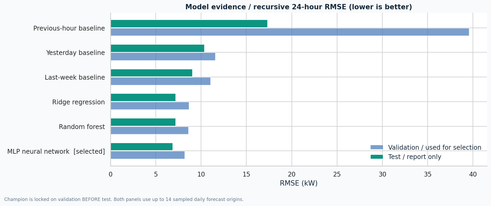
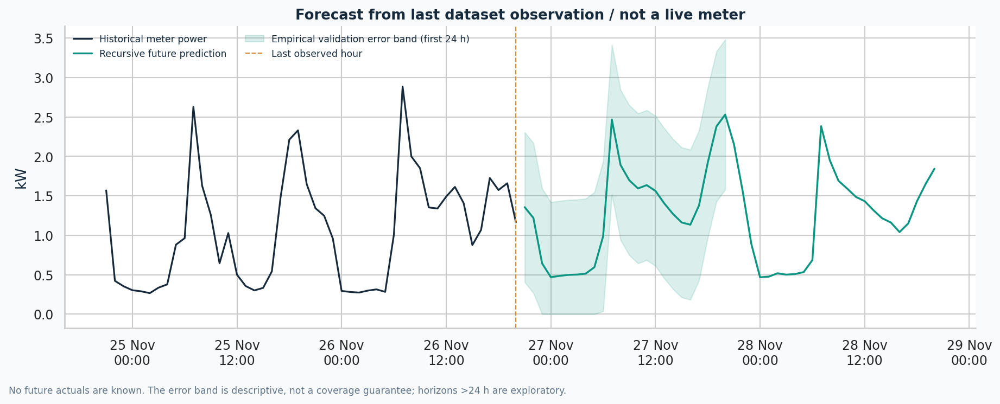

# Actual execution results

This report is generated from saved pipeline artifacts, not target or invented scores. Run `python scripts/export_results.py` after a verified rerun to refresh it. The supplied runs use seed 42, full settings, CPU execution and pinned direct dependencies.

## At a glance

| Dataset | Validation-selected model | Test one-step RMSE (kW) | Test one-step R² | Test 24 h RMSE (kW) | Test 24 h MAE (kW) | Test 24 h R² |
|---|---|---:|---:|---:|---:|---:|
| synthetic | MLP neural network | 6.711 | 0.831 | 6.888 | 5.485 | 0.829 |
| uci | Random forest | 0.466 | 0.567 | 0.598 | 0.448 | 0.253 |

One-step replay updates actual historical lags between predictions. A day-ahead origin recursively forecasts 24 hours without actual updates inside that window. Scores are not interchangeable. R² is not percentage accuracy. Different load scales make cross-site absolute RMSE comparisons inappropriate.

## synthetic: Virtual mixed-use building

- Source type: **synthetic**.
- Cleaned grid: **17,520 hours**, 2023-01-01 00:00:00 → 2024-12-30 23:00:00.
- Missing target hours before fill: 87; causal fills: 87; still missing: 0.
- Selected: **MLP neural network**, chosen on validation 24 h RMSE **8.197 kW**.
- Test observed one-step targets: **2,590**.
- Test day-ahead windows: **14 sampled daily origins × 24 h**, **335 observed targets scored**; imputed targets excluded.
- Test day-ahead WAPE: **5.86%**; MAPE: 6.09% (unstable at low load).
- Day-ahead RMSE reduction vs weekly-naive baseline: **24.01%**; this is forecast-error reduction, not energy saved.
- Empirical validation error radius: **13.662 kW**; observed test band coverage **92.84%** (no guarantee).
- Train/evaluate/final-refit stage elapsed here: 29.8 s; excludes data preparation, graph rendering and API startup. Hardware runtimes vary.
- Input SHA256: `c2f74ee2fa621b55946546a5bc8b655c435b7f3488c83e3d69ce8342549dc59b`.

### Actual candidate comparison

| Candidate | Selected | Validation 24 h RMSE | Test 24 h RMSE | Test one-step RMSE | Test 24 h R² |
|---|---|---:|---:|---:|---:|
| Previous-hour baseline | — | 39.566 | 17.339 | 11.025 | -0.085 |
| Yesterday baseline | — | 11.567 | 10.367 | 9.434 | 0.612 |
| Last-week baseline | — | 11.064 | 9.064 | 8.783 | 0.704 |
| Ridge regression | — | 8.683 | 7.205 | 6.959 | 0.813 |
| Random forest | — | 8.608 | 7.193 | 6.845 | 0.813 |
| MLP neural network | Yes | 8.197 | 6.888 | 6.711 | 0.829 |

All RMSE values are kW on that same source/task. Selection is locked before the test loop.

### Genuine future forecast, not future actuals

- Forecast cutoff: **2024-12-30 23:00:00**.
- Stored primary horizon: 24 hours, 2024-12-31 00:00:00 → 2024-12-31 23:00:00.
- Forecast energy: **2543.53 kWh**; forecast peak **131.96 kW** at 2024-12-31 19:00:00.
- `forecast_168h.csv` provides exploratory longer output. The empirical band stops after hour 24, because longer horizons were not validated here.

### Default hypothetical first-24-hour business scenario

- Energy before / after: **2543.53 / 2543.53 kWh**.
- Eligible energy actually moved in the heuristic: **62.65 kWh**.
- Baseline / shifted illustrative costs: **INR 20991.89 / 20553.34**.
- Hypothetical saving: **INR 438.55 (2.09%)**.
- Original / shifted peak: **131.96 / 130.67 kW**.
- Modeled carbon reduction: **0 kg**, because total energy is conserved under a constant illustrative intensity.
- Rates (INR 5 / 8 / 12), flexibility (10%), job timing and carbon factor are assumptions, not sourced tariffs or measured outcomes.

## uci: UCI Individual Household Electric Power Consumption

- Source type: **public_measured**.
- Cleaned grid: **34,587 hours**, 2006-12-16 18:00:00 → 2010-11-26 20:00:00.
- Missing target hours before fill: 444; causal fills: 33; still missing: 411.
- Selected: **Random forest**, chosen on validation 24 h RMSE **0.589 kW**.
- Test observed one-step targets: **4,895**.
- Test day-ahead windows: **14 sampled daily origins × 24 h**, **336 observed targets scored**; imputed targets excluded.
- Test day-ahead WAPE: **48.44%**; MAPE: 75.15% (unstable at low load).
- Day-ahead RMSE reduction vs weekly-naive baseline: **29.59%**; this is forecast-error reduction, not energy saved.
- Empirical validation error radius: **0.951 kW**; observed test band coverage **90.18%** (no guarantee).
- Train/evaluate/final-refit stage elapsed here: 55.0 s; excludes data preparation, graph rendering and API startup. Hardware runtimes vary.
- Input SHA256: `ab04febb691833420044cb47354c8466d1a2f2e0f366bc02eddcef4106f53b3c`.

### Actual candidate comparison

| Candidate | Selected | Validation 24 h RMSE | Test 24 h RMSE | Test one-step RMSE | Test 24 h R² |
|---|---|---:|---:|---:|---:|
| Previous-hour baseline | — | 1.095 | 0.920 | 0.584 | -0.767 |
| Yesterday baseline | — | 0.893 | 0.816 | 0.757 | -0.390 |
| Last-week baseline | — | 0.789 | 0.850 | 0.795 | -0.507 |
| Ridge regression | — | 0.671 | 0.629 | 0.499 | 0.174 |
| Random forest | Yes | 0.589 | 0.598 | 0.466 | 0.253 |
| MLP neural network | — | 0.628 | 0.569 | 0.495 | 0.325 |

All RMSE values are kW on that same source/task. Selection is locked before the test loop.

### Genuine future forecast, not future actuals

- Forecast cutoff: **2010-11-26 20:00:00**.
- Stored primary horizon: 24 hours, 2010-11-26 21:00:00 → 2010-11-27 20:00:00.
- Forecast energy: **31.30 kWh**; forecast peak **2.53 kW** at 2010-11-27 20:00:00.
- `forecast_168h.csv` provides exploratory longer output. The empirical band stops after hour 24, because longer horizons were not validated here.

### Default hypothetical first-24-hour business scenario

- Energy before / after: **31.30 / 31.30 kWh**.
- Eligible energy actually moved in the heuristic: **0.96 kWh**.
- Baseline / shifted illustrative costs: **INR 279.47 / 272.77**.
- Hypothetical saving: **INR 6.70 (2.40%)**.
- Original / shifted peak: **2.53 / 2.47 kW**.
- Modeled carbon reduction: **0 kg**, because total energy is conserved under a constant illustrative intensity.
- Rates (INR 5 / 8 / 12), flexibility (10%), job timing and carbon factor are assumptions, not sourced tariffs or measured outcomes.

## What should not be hidden

The measured UCI household is much less predictable in relative terms than the virtual building. Its selected model's day-ahead WAPE is 48.44%; the supplied evidence does not establish operational readiness. The test-best UCI MLP did not replace RF because RF had already won validation. That MLP's train+validation fit emitted a max-iteration convergence warning, visible in the real log.

Only up to 14 daily origins per split are sampled, with eligible history/target coverage. Results do not evaluate every test day, 48/168-hour accuracy, multisite transfer, current households or city-grid reliability. The final served model is refit on all history after held-out reporting; stored test scores are not in-sample scores from that final refit.

## Evidence locations

- `outputs/<run>/metrics.json`, `model_comparison.csv`, `split_report.json`.
- `one_step_predictions.csv`, `backtest_predictions.csv`, `horizon_metrics.csv`.
- `forecast.csv`, `forecast_168h.csv`, `forecast_meta.json`.
- `simulation.csv`, `simulation.json`, `logs/pipeline.log`.
- `models/<run>/metadata.json`, `data/raw/*.metadata.json`.
- `outputs/test-results.txt`, `verification.json`, `browser-checks.json`.
- Actual analytical plots and browser captures in `images/`.

See [MODEL_CARD.md](MODEL_CARD.md), [DATA_CARD.md](DATA_CARD.md) and [CLAIMS_AUDIT.md](CLAIMS_AUDIT.md) for scope. No business intervention, realized saving or live grid connection is claimed.
